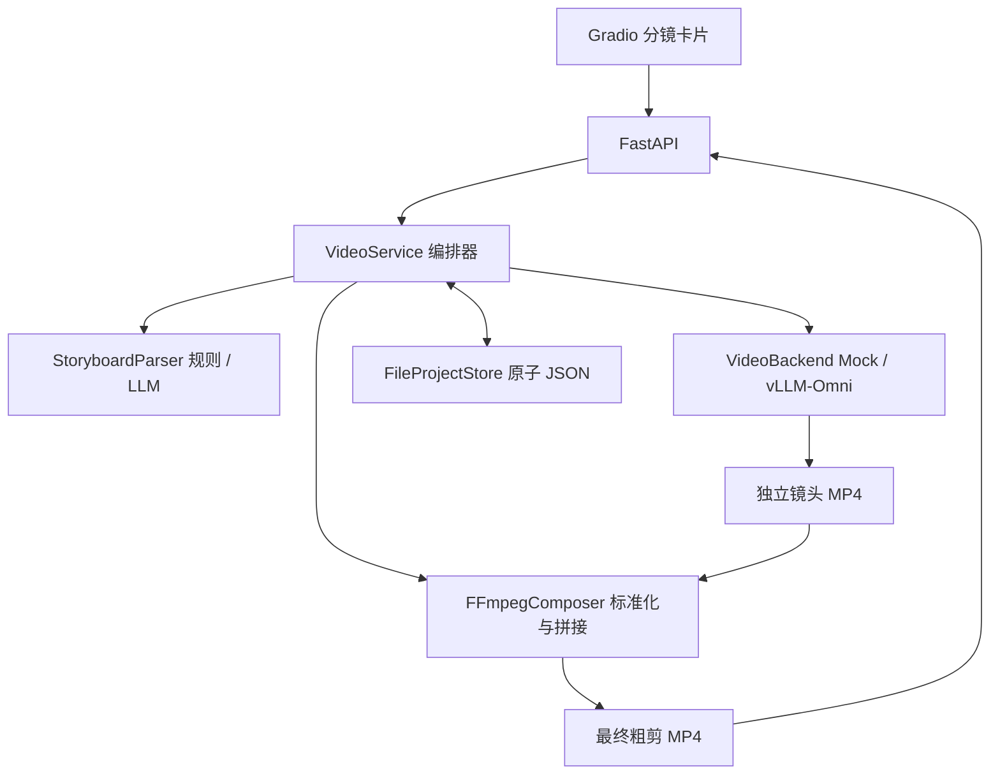

# 基于 vLLM-Omni 的 Agentic Video Generation Demo 设计与实施方案（优化版）

> 基于上传的 `vllm_omni_demo.md` 修订，保留 **Script-to-Rough-Cut、B-Roll、单镜头重投、时间轴归一化** 四项业务目标。MVP 可运行能力与后续扩展能力严格分开，不把规划内容当作已实现功能。

## 1. 定位、边界与验收

**目标**：输入剧本文案，形成可编辑分镜，逐镜头生成短视频、组装成可预览的粗剪，并且只重投发生变化的镜头。

| 能力 | 第一阶段可运行 MVP | 预留后续扩展 |
|---|---|---|
| 剧本 → 分镜 | 规则拆分；可选 OpenAI-compatible LLM 解析 | 多轮 Agent 剧情策划与结构化校验 |
| 文生视频 | FFmpeg Mock / vLLM-Omni T2V 异步视频任务 | I2V、V2V、多个模型的路由与能力协商 |
| 分镜编辑 | Prompt / 时长 / 运镜元数据、单镜头重投 | 引用图、角色档案、一致性评估 |
| 成片处理 | 归一化后无音轨粗剪、MP4 导出 | TTS、配乐、音频混合、Xfade、字幕 |
| 状态与恢复 | 单进程 asyncio + JSON 原子持久化 + 重启标记失败 | Redis/任务队列/分布式 Worker |
| 前端 | Gradio 分镜卡片、预览与手动/定时刷新 | 专业多轨拖拽时间轴 |

**验收目标**：默认 Mock 模式无 GPU 即可完成「输入剧本 → 3 镜头 → MP4 → 修改镜头 2 → 仅重投镜头 2 → 重新合成」；使用真实后端前必须确认目标模型的显存、帧数规则和推理耗时，不宣称所有 vLLM-Omni 模型参数兼容。

**MVP 非目标**：跨实例高可用、自动化多 Agent 决策、视频语义质量评分、工业级 A/V 精剪。与原文 1~2 周交付目标一致，先完成稳定可演示的窄闭环，再扩展。

## 2. 总体分层与数据流



设计原则：

1. **业务层不直接耦合模型 SDK**。分镜解析器、视频生成器、合成器通过清晰的方法契约注入；添加模型不修改状态流。
2. **镜头独立可重投**。每个 `Shot` 持有稳定 `id`、编辑 `revision` 与最近成功产物的 `rendered_revision`。只有两者一致且状态 READY 的片段参与合成。
3. **产物先完成、后提交**。新 MP4 使用独立版本文件名；下载并完成 FFmpeg 处理后才更新 JSON 指针，失败不覆盖上次成功镜头。
4. **项目级串行、生成全局限流**。同一项目一次仅允许一个生成/合成作业，不同项目共享信号量控制 GPU 峰值；默认并发 1。
5. **写入原子化**。写临时 JSON 后 `os.replace`，避免进程中断产生半写元数据；这不等同于分布式事务或多实例安全。
6. **严控 MVP 复杂度**。不新建 Redis、Celery、Kubernetes、消息总线、数据库抽象仓库。

### 模块与接口

| 模块 | 方法/作用 | 返回值 / 失败 |
|---|---|---|
| `StoryboardParser` | `parse(script, style, count)`：拆分剧本 | `list[ShotSpec]`；非法输出抛错 |
| `VideoBackend` | `generate(prompt, destination, duration)`：生成视频并落盘 | 异步返回 `None`；失败抛异常 |
| `VideoComposer` | `compose(clips, output)`：规格归一化与视频合成 | 返回 `None`；失败抛异常 |
| `FileProjectStore` | `load/save/recover_interrupted/asset` | `Project/None`；不存在抛 `KeyError` |
| `VideoService` | `create/edit/enqueue/get/close`：唯一业务编排入口 | `Project` 或 `None`；冲突抛 `WorkflowConflict` |
| `FastAPI` | 生命周期 HTTP API，向 Gradio 暴露服务 | JSON / MP4，状态码见 §4 |

`ShotSpec` 描述 Prompt、目标时长和运镜；`Shot` 增加 `id/revision/rendered_revision/status/video_path/error`；`Project` 管理脚本、统一风格、镜头列表、总状态、最终视频与错误。路径仅允许服务端生成的项目内 MP4 文件名，拒绝路径穿越。

## 3. 核心流程与状态机

### 3.1 创建与全量生成

1. 用户输入剧本、全局风格、分镜数；`POST /api/projects` 调用解析器，形成 `Project(DRAFT)`。
2. `POST /api/projects/{id}/generate` 将所有未生成或版本过期镜头标为 GENERATING，返回 202，不等待视频生成结束。
3. `VideoService` 在异步任务中逐镜头申请全局并发槽，调用对应 Backend，写入 `shot-{id}-r{revision}-*.mp4`。
4. 镜头真正落盘成功后才更新 `rendered_revision` 和 READY；其它镜头保持独立状态。
5. 所有镜头均 READY 且版本一致时，进入 STITCHING；标准化、合成并原子替换最终成片的元数据指针，项目 READY。
6. 前端轮询 GET 查询状态，再通过镜头/成片 URL 读取 MP4。

状态图：

```text
Project: DRAFT -> GENERATING -> STITCHING -> READY
                   |                |
                   +--------------> FAILED
READY -> DRAFT (编辑) -> GENERATING -> ...
FAILED -> GENERATING (显式重试) -> ...

Shot: PENDING -> GENERATING -> READY
                   |
                   +---------> FAILED -> GENERATING (重试)
```

生成任一分镜后若还有未就绪镜头，则项目返回 DRAFT，并不提前导出不完整成片。

### 3.2 单镜头重投

- PATCH 修改镜头 `k`：递增该镜头 `revision`；旧镜头文件不会立即覆盖；项目回到 DRAFT，当前成片不可再当作最新版本。
- POST `/shots/{k}/regenerate`：再次递增该镜头生成版本，**仅发起 k 的生成**；其余镜头产物及版本不变。
- 若重投成功，合成器以最新 `k` 与其余 READY 镜头组合出新的 MP4；成功后清理无引用的旧 MP4。
- 若重投失败，标记 FAILED，并保留旧镜头文件供诊断或重试；不会误将旧片视作当前版本。

### 3.3 异常与恢复

| 异常 | 当下处理 | 恢复入口 |
|---|---|---|
| 模型 API 创建/查询失败、超时、失败状态 | 记录 project/shot 错误，产物临时文件清理；vLLM-Omni 尝试 DELETE 异步任务 | 用户显式重试 |
| FFmpeg 拼接错误 | 项目标 FAILED；保留已成功分镜，不发布新成片 | 再次调用全量生成（已就绪镜头不重投） |
| 单项目并发编辑/生成请求 | HTTP 409；不抢占正在生成的版本 | 当前作业结束后操作 |
| 进程重启 | startup 扫描 GENERATING/STITCHING 标为 FAILED，不假装自动续跑 | 再次调用生成接口 |
| 输出尺寸/FPS 不统一 | FFmpeg 重编码，缩放并加黑边，音轨暂不处理 | 调整配置或模型输出 |

**已知限制**：持久化 + 重启标错不提供真正跨进程任务恢复；运行期任务只在当前 API 进程存在。避免使用多个 uvicorn workers 指向同一数据目录。

## 4. HTTP 接口

| API | 用途 | 成功 | 异常 |
|---|---|---|---|
| `POST /api/projects` | 创建剧本与分镜 | 201 + Project | 422 |
| `GET /api/projects/{id}` | 获取状态/错误/版本 | 200 + Project | 404 |
| `PATCH /api/projects/{id}/shots/{shot_id}` | 编辑 Prompt/时长/运镜 | 200 + Project | 404、409、422 |
| `POST /api/projects/{id}/generate` | 生成所有未就绪镜头，或重新合成 | 202 + Project | 404、409 |
| `POST /api/projects/{id}/shots/{shot_id}/regenerate` | 只重投目标镜头 | 202 + Project | 404、409 |
| `GET /api/projects/{id}/shots/{shot_id}/video` | 下载最新镜头 | 200 MP4 | 404、409 |
| `GET /api/projects/{id}/video` | 下载当前成片 | 200 MP4 | 404、409 |
| `GET /healthz` | API 进程健康检查 | 200 | - |

文件仍保存在本机 `AVG_DATA_DIR/{uuid}/`；默认不开放目录列表、任意文件上传或外部 URL 代理接口。上述 API 不含鉴权，因此默认只监听 127.0.0.1；公开部署前必须增加身份认证、配额/限流和安全存储。

## 5. vLLM-Omni 对接契约与 FFmpeg 修正

基于 2026 年 vLLM-Omni 官方 [Videos API](https://docs.vllm.ai/projects/vllm-omni/en/latest/serving/videos_api/) 与 [Text-to-Video 示例](https://github.com/vllm-project/vllm-omni/blob/main/docs/user_guide/examples/online_serving/text_to_video.md)：

- 推理服务与 Web/API 进程独立部署，例如 `vllm serve Wan-AI/Wan2.2-T2V-A14B-Diffusers --omni --port 8091`。
- **POST** `/v1/videos` 是 `multipart/form-data`，提交 `prompt/width/height/fps/num_frames/num_inference_steps` 等参数；创建任务得到 `id`，并不是一次性同步 MP4。
- **GET** `/v1/videos/{id}` 查询 `queued/in_progress/completed/failed`；completed 后 **GET** `/v1/videos/{id}/content` 下载。取消与错误时尽力 DELETE 原任务。
- 请求的帧数/分辨率/帧率**必须符合所选模型实际支持的范围和步进**，例如不同 Wan/LTX 模型的帧数约束不完全相同；需要做真实模型适配性测试。输入生成规格和成片输出规格分开配置。
- 不在该项目中包装/假定未验证的视频推理接口。Mock 是离线真实 MP4，不是模拟服务真实模型画面。
- `FFmpeg -c copy` 仅适用于兼容输入的流拷贝，不能承担跨模型帧率归一化、缩放、调时长、Xfade；本 MVP 显式 `fps/scale/pad/format/tpad/trim/concat` 重新编码 H.264 视频。
- **MVP 暂不实现音频**。先保证静音镜头可靠拼接，TTS/配乐/时间戳与转场在后续里程碑实现；不要在文档中将这些规划项标为已经交付。

## 6. 技术选型与可扩展切入点

采用 Python 3.10+、FastAPI、httpx、Pydantic v2、Gradio（可选安装）、FFmpeg；服务仅使用 asyncio。当前可替换扩展位：

- **模型扩展**：新增实现 `VideoBackend.generate` 的适配器并在 `build_service` 注册；为 I2V/V2V 增添显式资源引用/能力声明，不把模型特有参数塞进通用 `Shot`。
- **规划 Agent**：替换 `StoryboardParser.parse`；引入 LLM 分镜质量检查与人工确认环节，但保留确定性规则回退模式作为测试基线。
- **任务队列**：先保留 `VideoService` 与模型/合成协议；等需要跨进程调度时再替换运行器和存储实现。
- **音频**：新增语音生成/音画对齐模块，基于 narration timestamps 与音轨长度驱动镜头时长；与视频本身生成完全分离。
- **跨镜头一致性**：当前只有全局风格 Prompt，无法保证角色一致；后续考虑角色参考图、首尾帧条件、评估与返工闭环。
- **工作台**：MVP 卡片编辑 + 预览即可；需要专业多轨调整时再升级前端，不污染后端操作契约。

## 7. 14 天实施与验收

| 阶段 | 重点 | 验收 |
|---|---|---|
| Day 1-3：MVP 基础 | 项目骨架、Mock/Omni 适配器、规则/LLM 分镜、FFmpeg 基础合成 | Mock 三镜头完整生成；真实 Omni 请求协议测试 |
| Day 4-7：工作流可靠性 | 编辑版本、单镜头重投、项目状态、重试、原子文件 | 只重投改变的镜头；失败不污染已完成片段 |
| Day 8-10：前端与整合 | Gradio 卡片流、错误提示、视频预览、真实模型联调 | 浏览器完成端到端交互；模型参数验证 |
| Day 11-14：演示与加固 | 案例缓存、性能/显存基准、故障排练、SOP | 3~5 镜头、目标 12~20 秒演示；有完整日志和备用演示 |

**当前提交范围**：基础框架、API、Gradio、单测和 FFmpeg Mock 已实现；真实模型代码已对照 HTTP 文档，但**真实 GPU 上的 vLLM-Omni 连通性、显存性能及画面质量尚未验证**。TTS、Xfade、角色一致性和真正 B-Roll 检索/生成编排属于后续工作。

### 建议验收用例

1. Mock 无 GPU：3 镜头得到能播放的成片，镜头顺序和输出尺寸/FPS 正确。
2. 修改镜头 2：另外两镜头文件路径/版本不变，只额外生成 1 镜头，重新合成成功。
3. 模型报错/超时：项目 FAILED、错误可见，未发布半成品；重试可以恢复。
4. 同项目在生成中修改或重复提交生成：返回 409，无竞态覆盖。
5. 进程重启后：中断项目恢复为 FAILED；已有成功镜头可复用。
6. 输入不合法、项目不存在、路径穿越：400 级失败且不可访问任意文件。
7. 真机性能：记录 prompt、`num_frames`、FPS、显存峰值、任务时延、最终 MP4；不能以 Mock 结果替代模型验收。

**进一步的原则**：先让事实与实现一致，再逐个解除规划项。不要用“100% 演示稳定”的绝对表述替代真实模型的风险评估。
